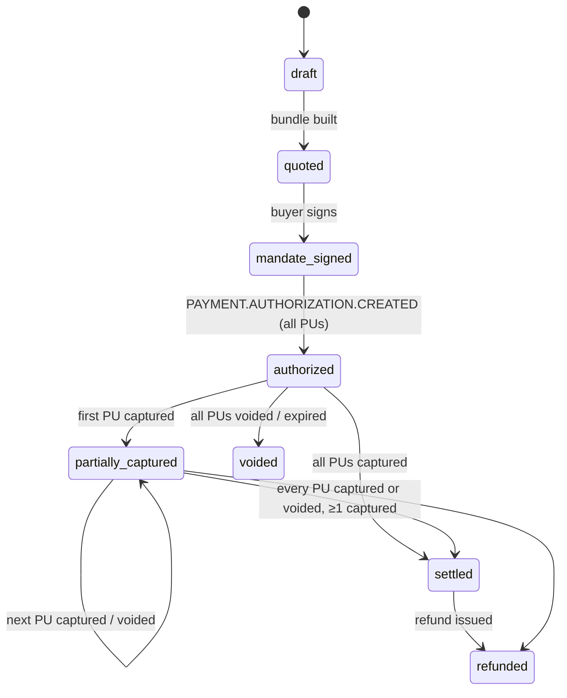

# Haggle — M0 Plan

Agent-native marketplace for small businesses. Merchant sales agents, buyer procurement agents, a deterministic Mandate Firewall, and escrow-style settlement on PayPal.

## 1. Stack

| Layer | Choice | Why |
|---|---|---|
| App | Next.js 15 (App Router) + TypeScript (strict) | One deployable for UI + API routes + SSE |
| UI | Tailwind + shadcn/ui + framer-motion | Premium look with little custom CSS |
| Grid | AG Grid Community (`ag-grid-react`) | Catalog editor + ledger (AG Grid prize) |
| DB | Postgres 16 + Drizzle ORM | Typed schema, simple migrations |
| Jobs | `pg-boss` (Postgres-backed queue) in a separate worker process | No Redis to run; boring and reliable |
| AI | Vercel AI SDK + `@ai-sdk/anthropic` | Swappable provider, `generateObject` with zod |
| Models | `claude-sonnet-5-5` (buyer agent, catalog vision, delivery check), `claude-haiku-5-5` (merchant agents, injection classifier) | Strong where reasoning matters, fast where volume matters |
| PayPal | Hand-written typed REST client (fetch) + PayPal JS SDK Buttons + `@paypal/agent-toolkit/ai-sdk` (wrapped by firewall) | Full control of idempotency, retries, debug logging |
| Tests | Vitest (+ v8 coverage, 100% gate on `lib/policy`), Playwright | |
| Deploy | Render Blueprint: web, worker, cron, Postgres | Render prize |

## 2. Folder structure

```
haggle/
├─ app/
│  ├─ (marketing)/page.tsx            # Landing
│  ├─ merchant/onboard/               # Upload → extract → AG Grid edit → guardrails → go live
│  ├─ merchant/[id]/orders/           # Fulfilment: mark delivered, upload photo
│  ├─ buy/new/                        # Request box + mic
│  ├─ buy/[rfqId]/mandate/            # Mandate form + sign
│  ├─ buy/[rfqId]/theater/            # Negotiation Theater (SSE)
│  ├─ buy/[rfqId]/checkout/           # Bundle + rationale + PayPal Buttons
│  ├─ orders/[orderId]/               # Settlement timeline
│  ├─ ledger/                         # AG Grid ledger
│  └─ api/
│     ├─ health/route.ts
│     ├─ catalog/extract/route.ts
│     ├─ rfqs/route.ts, rfqs/[id]/stream/route.ts (SSE)
│     ├─ mandates/route.ts
│     ├─ paypal/orders/route.ts, paypal/orders/[id]/authorize/route.ts
│     ├─ fulfilment/[puId]/route.ts
│     └─ webhooks/paypal/route.ts
├─ lib/
│  ├─ db/ (schema.ts, client.ts, seed.ts)
│  ├─ paypal/ (client.ts, auth.ts, orders.ts, payments.ts, payouts.ts, webhooks.ts, vault.ts, invoicing.ts, redact.ts)
│  ├─ policy/ (mandate-firewall.ts, injection.ts, types.ts)      # pure, 100% covered
│  ├─ state/ (order-machine.ts)                                   # pure transition table
│  ├─ agents/ (catalog-extractor.ts, buyer-agent.ts, merchant-agent.ts, delivery-verifier.ts, protocol.ts)
│  ├─ negotiation/ (engine.ts, bundle-solver.ts)
│  ├─ llm/ (provider.ts, demo-cache.ts)
│  └─ events/ (bus.ts — Postgres LISTEN/NOTIFY → SSE)
├─ worker/ (index.ts, jobs/negotiate.ts, jobs/process-webhook.ts, jobs/payout.ts, cron/expire.ts)
├─ components/ (ui/, theater/, ledger/, firewall-feed/, paypal-debug-panel/)
├─ scripts/ (replay-webhooks.ts, register-webhook.ts, fixtures/webhooks/*.json)
├─ tests/ (unit/, e2e/)
├─ docs/ (PLAN.md, DEVPOST.md, DEMO_SCRIPT.md)
├─ render.yaml, docker-compose.yml, .env.example, TODO.md, LICENSE, README.md
```

## 3. Data model (Drizzle, Postgres)

All money stored as **integer cents** + `currency` (USD). All tables have `id uuid pk`, `created_at`, `updated_at`.

| Table | Key columns |
|---|---|
| `merchants` | name, category, personality (`friendly`/`firm`/`upsell`), paypal_payout_email, min_margin_pct, max_discount_pct, lead_time_hours, daily_capacity, status (`draft`/`live`/`quarantined`), is_seeded |
| `catalog_items` | merchant_id, name, unit, list_price_cents, **floor_price_cents** (server-only), category, dietary_tags[], lead_time_hours, extraction_confidence |
| `buyers` | display_name, email (demo login) |
| `rfqs` | buyer_id, raw_request, parsed_line_items jsonb, deadline, status (`planning`/`negotiating`/`bundled`/`closed`) |
| `mandates` | buyer_id, rfq_id, budget_cap_cents, allowed_categories[], allowed_merchant_ids[], per_txn_approval_threshold_cents, expires_at, signed_at, signature (HMAC of canonical JSON), spent_cents, status (`active`/`expired`/`revoked`/`exhausted`) |
| `negotiations` | rfq_id, merchant_id, round_count, status (`open`/`accepted`/`rejected`/`timeout`/`quarantined`) |
| `offers` | negotiation_id, round, from (`buyer`/`merchant`), payload jsonb (typed offer), total_cents, valid_until, message, raw_llm_output |
| `bundles` | rfq_id, selected_offer_ids[], total_cents, first_quote_total_cents, rationale |
| `orders` | rfq_id, mandate_id, bundle_id, paypal_order_id, state (see §4), total_cents, platform_fee_bps |
| `merchant_allocations` | order_id, merchant_id, sku, amount_cents, paypal_authorization_id (shared), paypal_capture_id, state (`authorized`/`captured`/`voided`/`refunded`), delivery_photo_url, verifier_result jsonb |
| `paypal_events` | paypal_event_id **unique**, event_type, resource_id, raw jsonb, signature_verified bool, processed_at, error |
| `paypal_api_calls` | order_id, method, path, request_id, status, redacted_request, redacted_response, duration_ms (feeds debug panel) |
| `payouts` | purchase_unit_id, merchant_id, payout_batch_id, payout_item_id, gross_cents, fee_cents, net_cents, status |
| `firewall_decisions` | mandate_id, rfq_id, actor (agent id), action jsonb, decision (`allow`/`deny`/`needs_human`), reasons[], injection_flags[] |

## 4. Order state machine (`lib/state/order-machine.ts`)



Pure transition table; illegal transitions throw. Order state changes **only** in the webhook processor (source of truth); client callbacks just show "processing…".

## 5. PayPal integration map (sandbox: `https://api-m.sandbox.paypal.com`)

| # | API | Endpoint | Haggle use | Docs |
|---|---|---|---|---|
| 1 | OAuth | `POST /v1/oauth2/token` | Cached token, refresh 60s before expiry | https://developer.paypal.com/api/rest/authentication/ |
| 2 | Orders v2 | `POST /v2/checkout/orders` (`intent: AUTHORIZE`, one `purchase_unit` per merchant, `reference_id` = merchant id, Haggle as payee) | Create escrow order | https://developer.paypal.com/docs/api/orders/v2/#orders_create |
| 3 | Orders v2 | `POST /v2/checkout/orders/{id}/authorize` | Hold funds after approval | https://developer.paypal.com/docs/api/orders/v2/#orders_authorize |
| 4 | Orders v2 | `GET /v2/checkout/orders/{id}` | Reconcile | https://developer.paypal.com/docs/api/orders/v2/#orders_get |
| 5 | Payments v2 | `POST /v2/payments/authorizations/{id}/capture` (supports partial + `final_capture`) | Capture per merchant on verified delivery | https://developer.paypal.com/docs/api/payments/v2/#authorizations_capture |
| 6 | Payments v2 | `POST /v2/payments/authorizations/{id}/reauthorize` | Extend hold past honor period | https://developer.paypal.com/docs/api/payments/v2/#authorizations_reauthorize |
| 7 | Payments v2 | `POST /v2/payments/authorizations/{id}/void` | Undelivered → never charged | https://developer.paypal.com/docs/api/payments/v2/#authorizations_void |
| 8 | Payments v2 | `POST /v2/payments/captures/{id}/refund` | Dispute / refund | https://developer.paypal.com/docs/api/payments/v2/#captures_refund |
| 9 | Payouts v1 | `POST /v1/payments/payouts`, `GET /v1/payments/payouts/{batch_id}` | Pay merchant net of 3% fee | https://developer.paypal.com/docs/api/payments.payouts-batch/v1/ |
| 10 | Webhooks | `POST /v1/notifications/webhooks` | Register (script) | https://developer.paypal.com/docs/api/webhooks/v1/#webhooks_post |
| 11 | Webhooks | `POST /v1/notifications/verify-webhook-signature` | Verify **every** event | https://developer.paypal.com/docs/api/webhooks/v1/#verify-webhook-signature_post |
| 12 | Vault v3 (stretch) | `POST /v3/vault/setup-tokens`, `POST /v3/vault/payment-tokens` | "Save PayPal for my agent" | https://developer.paypal.com/docs/api/payment-tokens/v3/ |
| 13 | Invoicing v2 (stretch) | `POST /v2/invoicing/invoices`, `/send` | B2B net terms | https://developer.paypal.com/docs/api/invoicing/v2/ |
| 14 | JS SDK | Buttons, `intent=authorize` | Buyer checkout | https://developer.paypal.com/sdk/js/ |
| 15 | Agent Toolkit | `@paypal/agent-toolkit/ai-sdk` | Invoice/order tools for agents, every call routed through firewall | https://developer.paypal.com/tools/agent-toolkit |

**Webhooks subscribed:** `CHECKOUT.ORDER.APPROVED`, `PAYMENT.AUTHORIZATION.CREATED`, `PAYMENT.AUTHORIZATION.VOIDED`, `PAYMENT.CAPTURE.COMPLETED`, `PAYMENT.CAPTURE.REFUNDED`, `PAYMENT.PAYOUTS-ITEM.SUCCEEDED`, `PAYMENT.PAYOUTS-ITEM.FAILED`. Plus `INVOICING.INVOICE.PAID` (stretch). Event reference: https://developer.paypal.com/api/rest/webhooks/event-names/

**Client hygiene:** `PayPal-Request-Id` (uuid persisted per logical operation so retries are idempotent) on every POST; `Prefer: return=representation`; exponential backoff with jitter on 429/5xx (max 4); typed zod-parsed responses; every call logged to `paypal_api_calls` with tokens, emails and card data redacted.

## 6. AI architecture

- **CatalogExtractor**: `generateObject` with image/PDF/text input → zod `{items[], confidence}`. Low-confidence rows highlighted in AG Grid.
- **BuyerAgent**: plan line items → pick merchants (category match, not quarantined, allowed by mandate) → fan out RFQs → counter-offer strategy per round → `bundle-solver` (deterministic: small search over offer combinations, constraints = budget, coverage, dietary split, deadline) → LLM writes rationale *about* the solver's choice.
- **MerchantAgent**: personality prompt; sees list prices + guardrail *descriptions*, never floor numbers. Engine rejects sub-floor proposals and re-prompts (max 2 retries, then holds the previous price).
- **DeliveryVerifier**: vision pass/fail + reason; human override button.
- **Protocol**: zod `Offer {rfq_id, line_items, unit_prices, total, valid_until, terms, message}`; engine recomputes `total` from line items and rejects mismatches. Max 4 rounds, 20s per-turn timeout.
- **Mandate Firewall** (`lib/policy`): pure function `evaluate(mandate, action, context) → {decision, reasons[]}`. Rules: signature valid, not expired, status active, category allowed, merchant allowed + not quarantined, `spent + amount ≤ cap`, amount above threshold → `needs_human`, action type whitelisted for actor. Injection scanner (regex heuristics + optional Haiku classifier) flags instruction-like merchant text → quarantine merchant. **Authority only ever comes from the signed DB mandate, so a forged "pre-authorized $5,000" carries zero weight even if the scanner misses it.**
- **Demo mode**: `DEMO_MODE=true` → 5 seeded merchants (caterer, vegan bakery, print shop, florist, rogue "QuickPrint Pro"), fixed seed, cached LLM responses keyed by prompt hash in `lib/llm/demo-cache`. PayPal calls stay **real sandbox traffic** in both modes.

## 7. Risks and decisions to confirm

1. **AG Grid Community limits**: row grouping and sparklines are **Enterprise-only**. Plan: build group-by-order with a custom collapsible full-width row and draw sparklines with a small SVG cell renderer, all in Community. Switch to Enterprise only if you confirm a trial license is allowed.
2. **Multiple purchase units with AUTHORIZE: verified NOT supported** (sandbox, 2026-10-16: `UNSUPPORTED_INTENT`, "Only intent=CAPTURE is supported" for multi-PU). **Decision:** one purchase unit per bundle, with one item line per merchant (`sku` = merchant id), so the PayPal checkout still itemizes every merchant. That gives one authorization, then **one partial capture per merchant** (`final_capture: false` until the last), and any undelivered remainder is **voided**. Haggle is payee (marketplace model); merchants are paid net of fee by Payouts. The `purchase_units` table becomes `merchant_allocations` (same columns, with `paypal_capture_id` per merchant and a shared `paypal_authorization_id`). Verified: single-PU AUTHORIZE order with itemized merchants → `CREATED`, `authorize` link present.
   **Payouts: verified working** (sandbox batch `MZYYZ6EC7N9VC` → `PENDING`).
   **Scopes missing on the app:** Invoicing and Vault v3 (`payment-tokens`). Enable "Invoicing" + "Save payment methods" on the app if we want the M8 stretch items.
3. **Payouts in sandbox**: the REST app needs the **Payouts** feature enabled, and the sandbox business account needs balance. If it's off, I stop and tell you.
4. **Vault in sandbox**: often requires the "Vault" feature on the app. It sits behind `FEATURE_VAULT`.
5. **Render costs**: background workers and cron jobs are paid instance types, and free Postgres expires after 30 days. Budget about $7–20/mo, or run the worker inside the web service on the free tier.
6. **APIMatic context plugin**: in beta, MCP-based. PayPal's announcement doesn't publish install commands. The official alternative that does work in Claude Code: `/plugin install paypal@claude-plugins-official`, then `/reload-plugins`.

## 8. Milestones

M1 thin slice → M2 multi-merchant + SSE → M3 trust layer → M4 onboarding → M5 settlement + ledger → M6 design → M7 deploy + docs → M8 stretch. Tracked in `TODO.md`.
